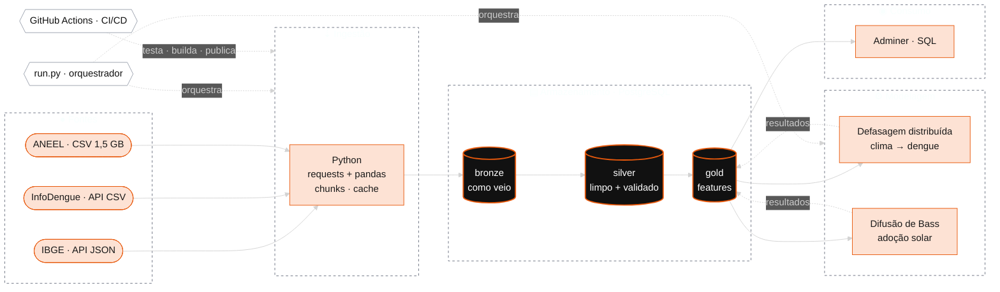

# climate-health-energy-medallion

[](https://github.com/AlyssonCaputti/climate-health-energy-medallion/actions/workflows/ci.yml)


O mesmo calor que acelera o ciclo do *Aedes aegypti* é o que faz um painel solar valer a pena.
Montei este projeto para olhar os dois lados dessa história com dados públicos do Paraná: **quanto o clima antecipa a dengue** e **como a energia solar se espalha de cidade em cidade**.

É um pipeline completo em arquitetura **medallion** (bronze → silver → gold), rodando em Docker, com testes, CI/CD e dois modelos que eu não vejo com frequência em portfólio: **defasagem distribuída** e **difusão de Bass**.

---

## Arquitetura



### As camadas

| Camada | Tabela | Linhas | O que tem |
|---|---|---|---|
| **bronze** | `ibge_municipios` | 5.571 | JSON do IBGE achatado, sem mexer em valor nenhum |
| | `infodengue` | 79.401 | 399 municípios × ~199 semanas (2023 → 2026) |
| | `aneel_gd` | 335.905 | Toda geração distribuída do PR, tudo como texto |
| **silver** | `dim_municipio` | 5.571 | Dimensão com o código IBGE, a chave que liga tudo |
| | `fato_dengue_semanal` | 79.401 | Casos, Rt, temperatura e umidade por município e semana |
| | `fato_solar_instalacao` | 335.781 | Só fotovoltaica, potência em número, sem cadastro inválido |
| **gold** | `dengue_features` | 79.401 | Fato + 8 semanas de defasagem de clima |
| | `solar_adocao_mensal` | 72.219 | 399 municípios × 181 meses, acumulado e per capita |
| | `ml_dengue_efeito_clima` | 8 | Efeito do clima por semana de defasagem |
| | `ml_solar_bass` | 359 | Parâmetros de difusão por município |

Toda tabela bronze carrega `_fonte` e `_ingerido_em`. Quando algo parece estranho lá na frente, eu consigo voltar e saber de onde e quando aquilo entrou.

---

## O que os dados mostram

**1. A dengue responde ao calor com até dois meses de atraso.**
Cada +1 °C na temperatura média mexe pouco nos casos da mesma semana, mas aumenta os casos **4 a 8 semanas depois** (+7% na oitava semana). Somando a janela toda, um calor sustentado de +1 °C significa **~26% mais casos**. É o tempo do mosquito se reproduzir e do vírus incubar, e é exatamente o tipo de sinal que dá pra usar como alerta antecipado.

| Semanas antes | 1 | 2 | 3 | 4 | 5 | 6 | 7 | 8 |
|---|---|---|---|---|---|---|---|---|
| +1 °C → casos | -0,2% | +0,4% | +1,1% | +2,0% | +3,1% | +4,3% | +5,6% | +7,2% |

**2. Solar se espalha por imitação, não por inovação.**
No Bass, o coeficiente de inovação (`p`) ficou praticamente zero e o de imitação (`q`) em ~0,06 ao mês. Na prática: quem instala, instala porque viu o vizinho instalar. Os líderes per capita (Itaipulândia, com 266 instalações por mil habitantes, Santa Helena e Entre Rios do Oeste) ficam todos na beira do lago de Itaipu. Minha hipótese é que os royalties da usina aceleram esse efeito vizinhança, e é o próximo fio que eu puxaria.

**3. Um alerta honesto sobre o Bass.**
O modelo diz que a maioria dos municípios está perto da saturação (~88%). Eu desconfio. O Marco Legal da geração distribuída (Lei 14.300) gerou uma corrida antes da mudança de regra em 2023 e uma freada depois, e o Bass lê essa freada como "mercado cheio". É uma quebra estrutural, e eu prefiro deixar isso escrito do que vender o número.

---

## Sujeiras reais que eu encontrei (e como tratei)

| Fonte | O problema | O que eu fiz |
|---|---|---|
| IBGE | Boa Esperança do Norte/MT (criado em 2025) vem sem microrregião | Uso a hierarquia nova do IBGE (região imediata), que está completa |
| InfoDengue | A API devolve `Localidade_id = 0`: a resposta não diz de qual cidade é | Marco o código do município na hora da ingestão |
| InfoDengue | ~1% das semanas sem dado de clima | Mantenho a linha; o modelo descarta só onde precisa |
| ANEEL | Arquivo de 1,5 GB descompactado | Leio direto do zip, em pedaços de 200 mil linhas |
| ANEEL | Potência como `",48"` (sem o zero) e decimal com vírgula | Converto no silver, com teste cobrindo o caso |
| ANEEL | 6 instalações cadastradas com `",00"` kW | Removo e registro quantas saíram |

As regras de limpeza do silver (decimal brasileiro, potência zero, duplicatas, granularidade) viraram testes em [`etl/tests`](etl/tests).

---

## Como rodar

Precisa só de Docker.

```bash
cp .env.example .env              # UF e ano inicial também ficam aqui
docker compose up -d              # Postgres + Adminer
docker compose run --rm etl       # pipeline inteiro: bronze → silver → gold → ml
```

A primeira execução leva uns 15 minutos (são 399 chamadas ao InfoDengue e um arquivo de 110 MB da ANEEL). Depois disso, dá pra rodar só o que mudou:

```bash
docker compose run --rm etl python run.py silver gold ml   # só as camadas que eu quiser
docker compose run --rm etl python bronze.py infodengue    # só uma fonte
docker compose run --rm etl python -m pytest -v            # testes
```

Para olhar os dados: http://localhost:8080 (sistema PostgreSQL, servidor `db`, usuário/senha/base do `.env`).

Quer outro estado? Troca o `UF` no `.env` e roda de novo. Nada no código muda.

---

## CI/CD

A cada push e pull request, o [GitHub Actions](.github/workflows/ci.yml) roda três etapas:

1. **Qualidade:** `ruff` + `pytest`. Rápido e sem banco, porque separei as transformações (funções puras) da leitura e escrita.
2. **Docker:** valida o compose, builda a imagem e sobe o Postgres para conferir que as três camadas nascem certas.
3. **Publicação:** em push na `main`, a imagem do ETL vai para o GitHub Container Registry, versionada pelo commit.

---

## Estrutura

```
├── docker-compose.yml       # Postgres, Adminer e o job de ETL
├── sql/init.sql             # cria os schemas bronze, silver e gold
├── etl/
│   ├── run.py               # orquestrador
│   ├── bronze.py            # ingestão das 3 fontes
│   ├── silver.py            # limpeza, tipos e validação
│   ├── gold.py              # features e agregações
│   ├── ml.py                # defasagem distribuída + Bass
│   ├── explorar_ibge.py     # o rascunho de exploração que deixei de propósito
│   └── tests/               # um teste para cada sujeira real
└── .github/workflows/ci.yml
```

---

## Próximos passos

- Defasagens de 12 semanas na dengue (o efeito ainda cresce na oitava) e splines no lugar do polinômio, no estilo DLNM completo.
- Bass com quebra estrutural em 2023, para separar a corrida do Marco Legal da saturação de verdade.
- Clima por satélite (NASA POWER) e IDH municipal (Ipeadata) como fontes extras.
- Bronze e silver em Parquet + DuckDB, para virar um lakehouse de verdade.

## Fontes

[IBGE Localidades](https://servicodados.ibge.gov.br/api/docs/localidades) · [InfoDengue (Fiocruz/FGV)](https://info.dengue.mat.br) · [ANEEL — Geração Distribuída](https://dadosabertos.aneel.gov.br/dataset/5e0fafd2-21b9-4d5b-b622-40438d40aba2)
